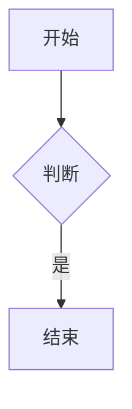

# 化学方程式测试夹具

对应《MarkView-化学方程式支持增量项目书》§7。用法：把本文件传到设备，用 MarkView 打开
（首页「打开文件」或系统「打开方式」均可），逐节核对。

预期结果与编号（CE01–CE08）来自项目书 §3 的功能合同。

## 7.1 基础与中文条件

行内：硫酸 $\ce{H2SO4}$、铵离子 $\ce{NH4+}$、硫酸根 $\ce{SO4^2-}$。

CA01 行内三个公式应嵌在文字中间：`H₂SO₄`（2、4 为下标）、`NH₄⁺`（4 下标、+ 上标）、
`SO₄²⁻`（4 下标、2− 上标）；周围文字正常换行，行高不被撑开。

CE04 反应系数与单向箭头：

$$
\ce{2H2 + O2 -> 2H2O}
$$

CE05 可逆反应：

$$
\ce{N2 + 3H2 <=> 2NH3}
$$

CE06 中文反应条件（重点：**加热**两个字必须完整可见，不被裁切、不缺字、不在箭头下方）：

$$
\ce{CaCO3 ->[加热] CaO + CO2}
$$

CE07 物态：

$$
\ce{CaCO3(s) -> CaO(s) + CO2(g)}
$$

CE08 溶液与液态：

$$
\ce{HCl(aq) + NaOH(aq) -> NaCl(aq) + H2O(l)}
$$

## 7.2 宽方程式（滚动与不撑宽页面）

$$
\ce{2KMnO4(aq) + 16HCl(aq) -> 2KCl(aq) + 2MnCl2(aq) + 5Cl2(g) + 8H2O(l)}
$$

同时把这条表达式放进行内：$\ce{2KMnO4(aq) + 16HCl(aq) -> 2KCl(aq) + 2MnCl2(aq) + 5Cl2(g) + 8H2O(l)}$

检查点：

- 块级：能在公式区域内左右滑动，**最左（2KMnO₄）与最右（8H₂O(l)）都能看到**；
- 行内：超宽公式自己局部滚动，**不会把整篇正文撑宽**（正文左右边界始终与其它段落一致）；
- 字号保持可读，不是被压扁的小字；上下不被裁切（箭头、下标、(aq)/(g) 完整）。

## 7.3 失败后继续渲染

$$
\ce{H2O
$$

AFTER_BAD_CHEM_OK：上方故意缺少右花括号，正文应继续显示。

$$
\ce{2H2 + O2 -> 2H2O}
$$

普通数学仍可显示：$a^2+b^2=c^2$。

检查点：坏公式显示原公式文本（或简短失败状态），**其后的合法化学公式与普通数学照常渲染**。

## 7.4 代码识别边界

行内代码：`\ce{H2O}` 和 `$\ce{H2O}$` 都应保持代码原样。

```text
\ce{2H2 + O2 -> 2H2O}
```

```chem
2H2 + O2 -> 2H2O
```

普通正文 H2O 不应被自动改写；裸 \ce{H2O} 不应触发渲染。

检查点：三处代码块/行内代码都按普通代码显示（`chem` 是未知语言，等同普通代码块）；
正文里的 `H2O` 与裸 `\ce{H2O}` 保持原样文字，不变成公式。

## 7.5 回归：原有渲染功能

普通数学无回归：

$$
\int_0^1 x^2 \, dx = \frac{1}{3}, \qquad
\begin{pmatrix} a & b \\ c & d \end{pmatrix}
$$

行内分数 $\frac{a}{b}$、上下标 $x_i^2$、根号 $\sqrt[3]{x}$。

Mermaid：



SMILES：

```smiles
CCO
```

检查点：分数、矩阵、根号与化学公式同时存在时互不影响；Mermaid 与 SMILES 各自流程未被破坏。

## 7.6 需要手动操作的项目（无法用文本验证）

| 项目 | 操作 | 通过标准 |
| --- | --- | --- |
| 飞行模式冷启动 | 开飞行模式，杀掉应用后重新打开本文件 | 所有化学公式与普通数学仍渲染（全部离线） |
| 深色模式 | 切换系统深色模式后重新打开 | 箭头、元素符号、上下标、中文条件都清晰可读 |
| 系统大字体 | 设置里把字体调到最大后重新打开 | 公式随之放大但不裁切；宽公式仍可滚动 |
| 横竖屏切换 | 打开本文件后旋转屏幕 | 保持当前文档，按新宽度重新排版 |
| 相对 Markdown 导航 | 在带化学公式的文档里点相对链接再返回 | 返回后公式仍正常，无需重新打开文件 |
| HTML / 协议探针 | 见《全面.md》既有章节 | 原有安全限制继续有效 |
